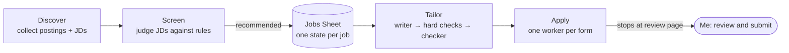

# Job Search Agents

A multi-agent pipeline I built and used for my own new-grad job search in 2026. LLM agents find
postings, screen them against written rules, tailor a fact-checked one-page résumé for each, and fill
the application form up to the final review page. I review every application and click Submit myself.
Each filled form ends with a review note to me, like [this example](docs/review-note-example.md).

By mid-November 2026 it had collected about 2,300 postings and I had submitted 229 applications, all
tracked in one Google Sheet. That Sheet is the system's only lasting state.



Each box is a workflow with its own package and tests. In this copy, Discover is only the fetching
and search-result checking library; the driver that runs collection and hands postings to Screen is not included. Agents run as
Paseo (`@getpaseo/cli`) sessions (Claude or Codex), so I can watch any of them live
and step in.

## Controlled autonomy

The agents do the repetitive work. Everything that is hard to undo or could misrepresent me stays
behind a check:

| Risk | Control | Where |
|---|---|---|
| An agent corrupts a job's state | Agents change a job's state only through `transition`. It checks the move against an allow-list and the live row, and prepends one line to the job's log. Agents only ever prepend to that log. They cannot move a job I set to `Skip` or `Submitted`. | `core/src/jobhunting_core/state.py`, `sheet.py` |
| Concurrent workers overwrite each other | One machine-wide lock per workbook. Columns are found by key, so I can reorder or hide them. | `core/src/jobhunting_core/sheet.py` |
| A résumé claims something untrue | A writer agent edits the master CV. Code first enforces the hard rules: one page, no changes to employers, dates or education, no hidden text, and (if configured) the key results still present. Then a separate checker agent verifies each changed claim against my career records; failures get one rework round. My career repository must be unchanged afterwards. | `tailor-resume/src/jobhunting_tailor/` |
| Private identity values leak | Passport and similar values live outside Git and are read only when a form asks. Once a job's form has used one, any state change or column update for that job containing the value is refused. | `core/src/jobhunting_core/private_identity.py` |
| An application goes out unreviewed | Workers stop at the form's final review page and send me a review note. I submit, or I tell that one worker in its own session to submit. | `apply-job/.agents/skills/apply-job/SKILL.md` |

The last control is the worker's written rules plus the workflow stopping at the review page. It is not a
technical lock on the Submit button. The log does record every agent move to `Submitted`, with
the state it came from.

## What is in this repository

This is a cleaned-up copy of my working repository, without its git history:

- `core/`: shared infrastructure. Sheet access and the workbook lock, the state machine, the posting
  key used for deduplication, Paseo calls and Google credentials.
- `screen-job/`: screening agents, rescreening when the rules change, and deduplication. Two rows are the
  same job when company and title match loosely and their JDs share at least half their word 5-grams.
  A row without a JD is never matched by guessing, with one exception: when either row lacks a JD, a
  company and title match with a job I already submitted counts as a duplicate of it.
- `tailor-resume/`: the writer, hard checks, checker and rework loop.
- `apply-job/`: daily preparation (tailoring each chosen job, run after Screen's dedupe) and the fill
  dispatcher. The dispatcher keeps
  up to N form-filling workers running, one per job.
- `discover-job/`: fetching postings from public job-board APIs (Greenhouse, Lever, Ashby, Workable),
  from the JSON endpoints behind some career sites (Workday and others), and from Indeed through JobSpy.

**Left out on purpose:** my personal documents (screening criteria, search strategy, career facts), the
browser-agent collection from job boards, the form-filling helper scripts and account setup, and
deployment units. The form-filling worker's rules are included, with those details removed.
`docs/screening-rules.md` is a generic example.

Each job has one state in the Sheet:

| State | Meaning |
|---|---|
| `Apply` / `AI recommends` | to apply (chosen by me / recommended by Screen); both behave the same |
| `Ready to fill` | résumé ready, form waiting to be filled |
| `Submitted` | submitted by me |
| `Skip` | not applying |
| `Duplicate` | duplicate of another row |
| `Closed` | posting closed |
| `Missing JD` | waiting for its JD before deduplication |

See [docs/design.md](docs/design.md) for the main decisions and what I learned from running it.

## Running the tests

Python 3.12+ and [uv](https://docs.astral.sh/uv/). Each workflow runs its own tests offline:

```bash
uv sync --group dev
cd core && uv run --group dev python -m pytest   # likewise screen-job, tailor-resume, apply-job, discover-job
```

Running the pipeline itself needs a Google Sheet with the expected tabs, the Paseo CLI, Chrome with
remote debugging and the `agent-browser` CLI, and a local Bitwarden `bw serve` for credentials. Copy `.env.example` to `.env`
for your settings; the spreadsheet ID goes in `campaign.toml`. It was built for my own machine, not as a turnkey tool.

## How it was built

I designed the system and its rules and reviewed the changes. Most of the code was written by AI coding
agents (Claude Code and Codex) working under that design.
